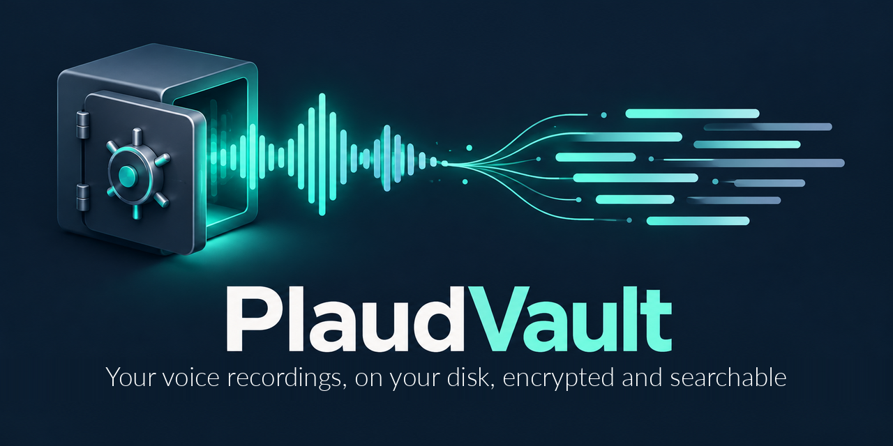
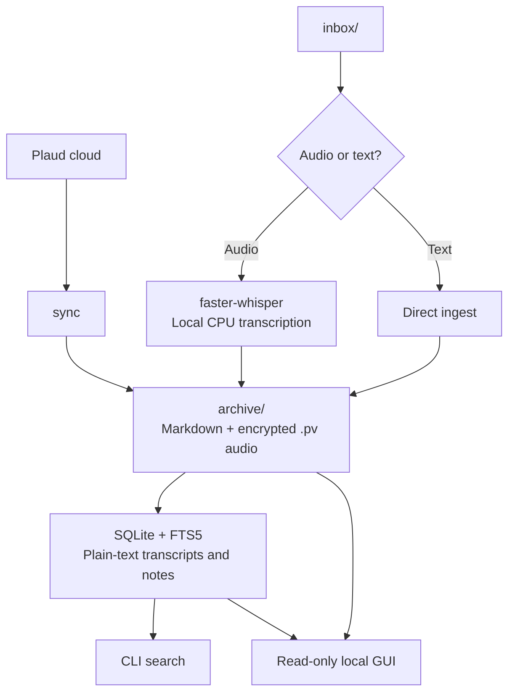

# PlaudVault

<p align="center">
  
</p>

<p align="center">
  A local vault for your voice recordings and their generated notes: import, transcribe, search and keep the audio encrypted on your own disk.
</p>

<p align="center">
  <a href="README.md">Español</a> · <b>English</b>
</p>

<p align="center">
  <a href="LICENSE"></a>
  
  
  
  
  
  <a href="#security"></a>
  <a href="https://github.com/D4vRAM369/PlaudVault/commits"></a>
  <a href="https://github.com/D4vRAM369/PlaudVault/stargazers"></a>
</p>

<p align="center">
  <a href="#installation">Installation</a> ·
  <a href="#usage">Usage</a> ·
  <a href="#gui">GUI</a> ·
  <a href="#security">Security</a> ·
  <a href="#roadmap">Roadmap</a>
</p>

Your recordings, back on your own disk. PlaudVault is a local vault for your voice
recordings and their generated notes, from Plaud Note or any other source, with local transcription,
search and audio encryption.

**Encryption protects the audio only.** Transcripts, notes and infographics
stay in plain text. It protects against disk theft, not against active malware
in your session. The "zero trace" GUI requires Linux and a Chromium-family
browser; its conditions and limits are explained under [Security](#security).

## ✨ What it does

- ☁️ **Imports your Plaud history**, with audio, transcripts, notes and infographics.
- 🎙️ **Transcribes audio locally** with faster-whisper; text files are ingested as-is.
- 🔎 **Searches transcripts and notes** with SQLite + FTS5, accent-insensitive.
- 🔐 **Encrypts the audio** with AES-256-GCM and a key derived from your passphrase with Argon2id.
- 🖥️ **Lets you browse, search and listen** from a read-only local GUI.
- 📁 **Organizes the archive by month and by Plaud folder**, with optional Telegram notifications.

## How it works



When ingesting from `inbox/`, the transcript is indexed and searchable; the
original audio is encrypted with AES-256-GCM, using a key derived with Argon2id,
and the plain-text file is deleted. An optional Telegram notification can be
sent when it finishes.

## Installation

### Linux installer — v0.3.0

Download the `.deb` and `SHA256SUMS` from [Releases](https://github.com/D4vRAM369/PlaudVault/releases). Initial compatibility: **Ubuntu 24.04 x86_64**. The package includes Python, the CLI and the Tauri GUI: you don't need to clone the repository, Node or Rust. `apt` installs the declared system libraries (WebKitGTK, GTK, bubblewrap and GStreamer).

```bash
sha256sum --ignore-missing --check SHA256SUMS
sudo apt install ./plaudvault_0.3.0_amd64.deb
plaudvault init
plaudvault desktop
```

`init` asks for the passphrase; keep it safe, because there is no recovery. The app also shows up in the applications menu. The GUI is read-only: **the token and sync stay in the CLI**. In the examples of this guide, the package uses `plaudvault` instead of `python -m plaudvault`; the desktop app opens with `plaudvault desktop`.

The installed configuration looks for `$XDG_CONFIG_HOME/plaudvault/config.yaml` or `~/.config/plaudvault/config.yaml`. If it doesn't exist, it uses the bundled template with paths under `~/PlaudVault`, without creating a configuration when the GUI opens. To customize it:

```bash
mkdir -p ~/.config/plaudvault
cp /usr/share/doc/plaudvault/config.example.yaml ~/.config/plaudvault/config.yaml
```

`-c` still lets you pick another configuration. The first audio transcription may download the Whisper model; models are not included in the package.

### Portable

The same release ships `PlaudVault-0.3.0-linux-x86_64.tar.gz`. It includes Python, but needs the system libraries; it is not an AppImage or a static binary.

```bash
sudo apt install libwebkit2gtk-4.1-0 libgtk-3-0t64 bubblewrap gstreamer1.0-plugins-good gstreamer1.0-libav
tar -xzf PlaudVault-0.3.0-linux-x86_64.tar.gz
cd PlaudVault-0.3.0-linux-x86_64
./plaudvault init
./plaudvault desktop
```

Check `SHA256SUMS` first. To uninstall the `.deb`, run `sudo apt remove plaudvault`: the program does not include your personal vault and uninstalling does not remove it. See [the packaging guide](packaging/README.md) (Spanish) and [the security conditions](assets/tauri-security.md) (Spanish). Compatibility with other distributions or architectures has not been established.

### From source

```bash
git clone https://github.com/D4vRAM369/PlaudVault.git && cd PlaudVault
python -m venv .venv && source .venv/bin/activate
python -m pip install -e .            # installs the `plaudvault` command
python -m pip install -e '.[gui]'     # optional: local web interface
cp config.example.yaml config.yaml    # adjust paths if you want
```

Use `python -m pip` rather than plain `pip`: that way you install into the
venv's Python even if you have other Pythons on the system.

To run the tests (no network or credentials needed; the GUI test needs `ffmpeg`):

```bash
python -m pip install -e '.[gui,test]'
for t in tests/test_*.py; do python "$t"; done
```

## Usage

```bash
python -m plaudvault init                      # create vault + passphrase
python -m plaudvault run                       # watcher on inbox/
python -m plaudvault ingest ~/audio/impro.mp3  # single file
python -m plaudvault search "soberanía"        # full-text (accent-insensitive)
python -m plaudvault list
python -m plaudvault decrypt 7 -o ~/recovered
python -m plaudvault sync --limit 3            # import from the Plaud cloud
python -m plaudvault.gui                       # local web interface (read-only)
```

### Plaud token (for `sync` and `reclassify`)

`sync` and `reclassify` talk to the Plaud cloud using **your web session**:
the same *Bearer* token your browser sends with every request. Plaud offers no
official API or API keys, so you have to copy it from there.

> ⚠️ **The token gives full access to your Plaud account** until it expires.
> Don't paste it into chats, issues or screenshots, don't save it to files
> (`config.yaml`, `.bashrc`, `.env`) and don't share it. PlaudVault never
> writes it to disk.

**1. Extract it from the browser**

1. Open [web.plaud.ai](https://web.plaud.ai) and sign in.
2. Open the developer tools: `F12` (or `Ctrl+Shift+I`; on macOS `Cmd+Opt+I`).
3. Go to the **Network** tab.
4. Reload the page (`F5`) so the requests show up.
5. Type `plaud.ai` in the filter and click any request to
   `api.plaud.ai` or `api-euc1.plaud.ai` (for example `simple/web` or `detail`).
6. Under **Headers** → **Request Headers**, find `authorization`. Its value
   starts with `bearer eyJ…`.
7. Right-click that line → **Copy value**.

The `tokenstr` in *Local Storage* won't work (it doesn't always exist, or it's
a different token). It doesn't matter whether you copy the value with `bearer `
in front, in quotes, or the whole `authorization: bearer …` line: PlaudVault
extracts the JWT from whatever you paste.

**2. Load it in the terminal**

In the terminal where you'll run `sync`, with the venv activated:

```bash
read -rs PLAUD_TOKEN && export PLAUD_TOKEN
```

Paste the token (`Ctrl+Shift+V`) and press **Enter**. **You won't see anything**
when pasting: `-s` hides what you type, and `read` keeps the token out of the
shell history (`~/.bash_history`), which `export PLAUD_TOKEN=…` would not.

Check that it loaded **without showing it**:

```bash
[ -n "$PLAUD_TOKEN" ] && echo "token loaded (${#PLAUD_TOKEN} characters)"
```

It should say about 550 characters. If it says `0` or nothing, repeat the step.

**3. Use it**

```bash
python -m plaudvault sync --limit 3   # try with 3 recordings
python -m plaudvault sync             # the whole history (repeatable: only fetches what's new)
```

- The token lives **only in that terminal**: if you close it, or open another,
  you have to load it again.
- **It expires after about 24 h.** If `sync` fails with `401 Unauthorized`, get
  a new one (step 1) and load it again (step 2).
- If it says `PLAUD_TOKEN no contiene un JWT` ("does not contain a JWT"), you
  copied something else: the error describes the shape of what you pasted
  (length, whether it starts with `eyJ`), never its content.
- When you're done, you can remove it from the session with `unset PLAUD_TOKEN`.

<a id="gui"></a>

## Graphical interface (read-only)

The local web GUI uses FastAPI and lets you browse the archive without working
from the terminal. Opening it in "zero trace" mode requires **Linux and a
Chromium-family browser**.

```bash
python -m plaudvault.gui            # opens an ephemeral Chromium/Thorium window
python -m plaudvault.gui --no-browser   # only prints the URL (no zero-trace guarantee)
```

- Browse `archive/` (also after `reclassify`): transcript, outline and notes
  with their infographics. It ignores `*.partial` folders from a sync in
  progress and refreshes itself every 10 s.
- Search everything (FTS5) with highlighted snippets.
- Unlock with your passphrase and the audio is **decrypted in memory** and
  served to the player; a plain `.mp3` is never written.
- Opens the database **read-only**: it can stay open while `sync` runs.

To try it without touching your vault: `python tests/make_gui_fixture.py /tmp/pv-gui`
and then `python -m plaudvault.gui -c /tmp/pv-gui/config.yaml` (passphrase `test`).

### Tauri + Svelte desktop (experimental)

The second interface keeps the read-only local API and adds the
**Bóveda nocturna** ("Night Vault") design: folders, library and documents in
three columns. Both interfaces show Plaud recordings and those ingested from
local files; they let you search, read and listen without modifying the archive.

It requires Linux, Rust and the WebKitGTK development libraries. After
installing the `gui` extra, build from the repository root:

```bash
npm --prefix desktop ci
npm --prefix desktop run build
cargo build --locked --manifest-path desktop/src-tauri/Cargo.toml
python -m plaudvault.desktop
```

The release includes the installer and a bundled Python backend. To build from source, see the
[desktop guide](desktop/README.md) for requirements and options, and the
[HTML gallery](mockups/index.html) for the visual explorations.

Tauri uses WebKitGTK on Linux, so its security is tested separately from
Chromium. Playback and seeking were verified with a 38.4 MB synthetic MP3,
sandboxed renderer, media temporaries in RAM and normal/forced shutdown.
The launcher refuses a session without tmpfs or without a verifiable sandbox.
These tests back the measured configuration; they are not a universal
"zero trace" guarantee. See the
[conditions, procedure and limits](assets/tauri-security.md) (Spanish).

## Importing from the Plaud cloud

`sync` downloads your whole history into folders grouped by month. It is
idempotent: running it again only fetches what's new, and each folder is
written atomically. `--transcribe-missing` uses whisper to transcribe the
recordings Plaud didn't transcribe.

It needs your web.plaud.ai session token in the `PLAUD_TOKEN` variable: see
[Plaud token](#plaud-token-for-sync-and-reclassify) (how to extract and load it).

<details>
<summary>📁 Layout of an imported recording</summary>

```
archive/10-26/2026-10-14_2049_Meeting/
├── audio.pv           # encrypted audio
├── transcript.md      # with timestamps and speakers
├── outline.md
├── notes/01_Summary.md, 02_….md   # one per template
└── assets/*.png       # infographics, linked from the notes
```

</details>

### Reorganize by Plaud folder

The folders you have in Plaud are stored as each recording's category.
After a `sync`, `reclassify` reorganizes the archive:

```bash
plaudvault reclassify --dry-run   # shows what would be moved
plaudvault reclassify             # archive/<Folder>/MM-YY/<recording>/
plaudvault list --categories      # folders and number of recordings
plaudvault list --category Ideas
```

It locates each recording by its `.plaud_id` marker (not by path), updates the
audio path in the database and is safe to repeat. It won't run if it detects a
`sync` in progress.

All access to the Plaud web API is isolated in `plaudvault/plaud_client.py`.

### Telegram notifications (optional)

Set `telegram.enabled: true` in config.yaml and export
`TELEGRAM_BOT_TOKEN` and `TELEGRAM_CHAT_ID` in the environment.

## Security

### Security model: what it protects / what it doesn't

| Protects | Does not protect |
|---|---|
| The confidentiality of the **encrypted audio** against disk theft, using AES-256-GCM and Argon2id. | **Transcripts and notes**, which stay in plain text so they can be searched. |
| The GUI avoids leaving browsing and audio traces on disk under the stated conditions: Linux, ephemeral Chromium with a RAM profile, verified sandbox and no internet access. | Against **active malware in your session**. |
| The audio stays encrypted without your passphrase. | Recovery if you lose the passphrase: **no recovery is possible**. |

<details>
<summary>🔐 Audio encryption and passphrase handling</summary>

- The passphrase is **never** stored. An AES-256 key is derived with
  Argon2id (64 MiB, t=3) on each session and checked against
  `vault.keycheck`.
- The **audio** is encrypted; transcripts, notes and infographics stay in plain
  text so FTS5 can index them. It protects against disk theft, not against
  active malware in your session.
- **Metadata** also stays in plain text: date, time and title in folder names
  (`archive/<Folder>/MM-YY/YYYY-MM-DD_HHMM_<name>/`), and duration, Plaud
  folder and hashes in `vault.db`. To cover them, keep `~/PlaudVault` on
  full-disk encryption (LUKS) or inside a VeraCrypt container. `sync` deletes
  nothing from the Plaud cloud.
- Without the passphrase there is no possible recovery. There is no backdoor.

</details>

<details>
<summary>🖥️ GUI security and "zero disk trace" conditions</summary>

Local server security: it only listens on `127.0.0.1`, the startup URL carries
a one-time token that is exchanged for a session cookie, it rejects foreign
`Host` headers (DNS rebinding), strict CSP (notes are rendered without HTML or
remote images) and auto-lock after 15 min of inactivity.

**Zero disk trace.** The server not writing the `.mp3` is not enough: the
browser decides on its own what to store (history, autofill, passwords,
caches). That's why the GUI:

- opens a Chromium-family browser (Thorium, Chromium, Chrome, Brave, Edge) in
  app mode with a **fresh profile in RAM** (tmpfs, checked in `/proc/mounts`)
  that is deleted when the window closes;
- checks in `/proc` that it runs **sandboxed** (no `--no-sandbox`, renderers
  with seccomp) and refuses to open otherwise;
- cuts off its network: it can only talk to `127.0.0.1`;
- serves audio only through Range requests and everything with
  `Cache-Control: no-store`, with no personal data in the URL, no forms and no
  password field the browser would want to save.

This was verified with an experiment (Chromium, Thorium and Firefox; 1.4 and
36.5 MB audio files) searching the disk for chunks of the decrypted audio:
loading the audio as a Blob leaves it on disk in all three, and Firefox dumps
it to `/tmp` even with Range. That's why Firefox is not supported. Without a
Chromium browser or without tmpfs (macOS, Windows), the GUI warns you instead
of opening your regular browser. Limit: if your swap is not encrypted, RAM may
end up on disk.

</details>

<details>
<summary>💾 SQLite backups</summary>

`vault.db` runs in **WAL** mode: next to it you'll see `vault.db-wal` and
`vault.db-shm`. They are part of the database, **don't delete them**. To copy
it without closing anything, use SQLite's backup API:

```bash
python -c "import sqlite3; sqlite3.connect('vault.db').backup(sqlite3.connect('copy.db'))"
```

</details>

## Troubleshooting

<details>
<summary>🛠️ Token, browser and GUI limits</summary>

- **`401 Unauthorized` when importing:** see
  [Plaud token](#plaud-token-for-sync-and-reclassify) to get and load a new
  session.
- **`PLAUD_TOKEN no contiene un JWT`:** the same section explains which value to
  copy; the error describes its shape, never its content.
- **The GUI doesn't open the browser:** it needs Linux, a Chromium-family
  browser and tmpfs. If the security conditions aren't met, it warns you.
- **Firefox:** not supported, because the experiment found audio in `/tmp` even
  when using Range requests.
- **Using `--no-browser`:** offers no zero-trace guarantee.
- **Unencrypted swap:** RAM may end up on disk; see the detailed limits under
  [Security](#security).

</details>

## Structure

<details>
<summary>🗂️ Modules, tests and templates</summary>

```
plaudvault/
├── __main__.py      # CLI (init, run, ingest, search, show, list, decrypt, sync, reclassify)
├── config.py        # config.yaml loading
├── db.py            # SQLite + FTS5 + triggers
├── crypto.py        # Argon2id + AES-256-GCM
├── transcriber.py   # faster-whisper (audio) / passthrough (text)
├── pipeline.py      # ingest orchestration
├── plaud_client.py  # Plaud web API (region, pagination, S3)
├── sync.py          # cloud import into monthly folders
├── reclassify.py    # reorganizes archive/ by Plaud folder
├── gui.py           # read-only local web interface (FastAPI)
├── gui_static/      # HTML + JS + CSS, no build step
├── notifier.py      # Telegram (direct HTTP)
└── watcher.py       # watchdog on inbox/
tests/               # python tests/test_*.py (no network or credentials)
templates/           # CoSTAR templates (phase 1.5, not active yet)
```

</details>

## Roadmap

- **MVP (this):** ingest, transcription, encryption, search, outgoing Telegram.
- **1.5:** LLM enrichment with CoSTAR templates (Anthropic/Ollama).
- **Obsidian (possible future integration, no date):** export each recording
  as a Markdown note with frontmatter (date, duration, Plaud folder) and
  wikilinks between transcript, summary and notes, so they open in an Obsidian
  vault. The `archive/` folders are already Markdown, so the format is close.
  The audio would stay encrypted; exported text is plain wherever you keep it
  (watch out for Obsidian Sync or other clouds).
- **2:** Desktop UI. 🔄 First step done: read-only local web GUI
  (`plaudvault.gui`) and first experimental Tauri v2 + Svelte 5 version
  (`plaudvault.desktop`) on top of the same API. First release with `.deb` and portable build for Ubuntu 24.04 x86_64;
  validation on more environments pending. Two-way Telegram bot pending.
- **3:** ~~syncer for the unofficial Plaud API~~ ✅ done (`sync`).

## License

[GPL-3.0](LICENSE)

---

Unofficial project, not affiliated with Plaud. It uses an undocumented web API that may change.
