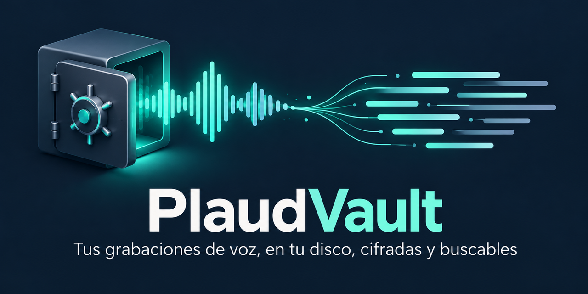
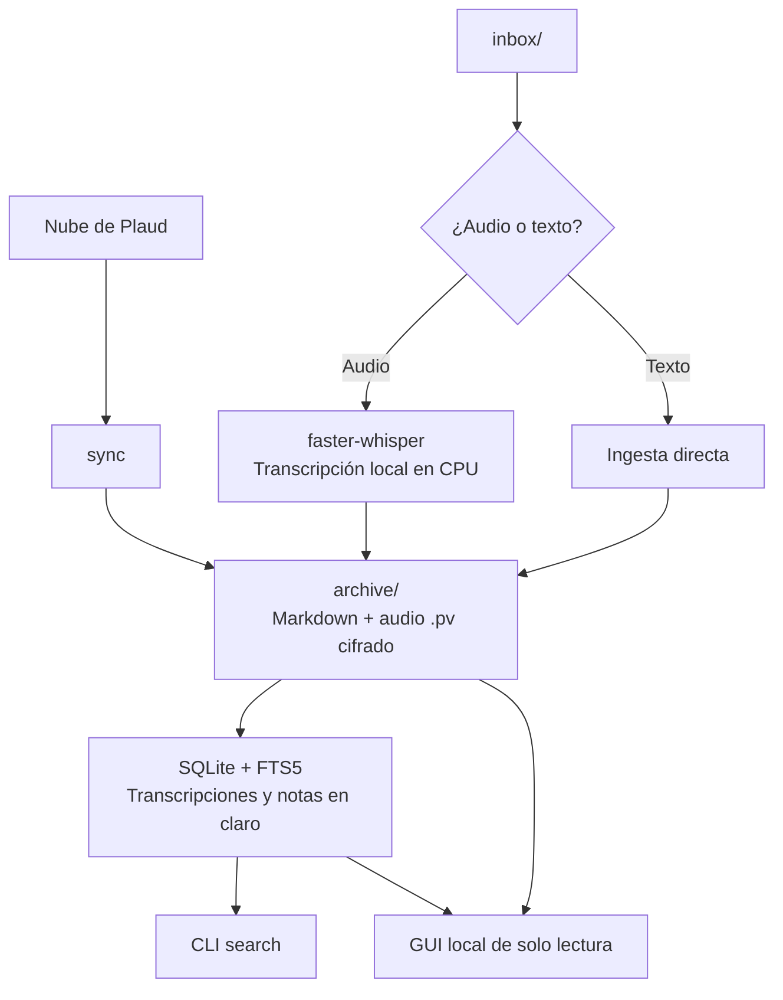

# PlaudVault

<p align="center">
  
</p>

<p align="center">
  Bóveda local para tus grabaciones de voz: importa, transcribe, busca y guarda el audio cifrado en tu disco.
</p>

<p align="center">
  <a href="LICENSE"></a>
  
  
  
  
  
  <a href="#seguridad"></a>
  <a href="https://github.com/D4vRAM369/PlaudVault/commits"></a>
  <a href="https://github.com/D4vRAM369/PlaudVault/stargazers"></a>
</p>

<p align="center">
  <a href="#instalación">Instalación</a> ·
  <a href="#uso">Uso</a> ·
  <a href="#gui">GUI</a> ·
  <a href="#seguridad">Seguridad</a> ·
  <a href="#roadmap">Roadmap</a>
</p>

Tus grabaciones vuelven a tu disco. PlaudVault es una bóveda local para
grabaciones de voz de Plaud Note o cualquier fuente, con transcripción local,
búsqueda y cifrado del audio.

**El cifrado protege solo el audio.** Las transcripciones, notas e infografías
quedan en claro. Protege contra robo del disco, no contra malware activo en tu
sesión. La GUI «cero rastro» necesita Linux y un navegador de la familia Chromium;
sus condiciones y límites se explican en [Seguridad](#seguridad).

## ✨ Qué hace

- ☁️ **Importa tu histórico de Plaud**, con audio, transcripciones, notas e infografías.
- 🎙️ **Transcribe audio en local** con faster-whisper; si ya es texto, lo ingiere directamente.
- 🔎 **Busca en transcripciones y notas** con SQLite + FTS5, sin preocuparte por las tildes.
- 🔐 **Cifra el audio** con AES-256-GCM y una clave derivada de tu passphrase con Argon2id.
- 🖥️ **Permite navegar, buscar y escuchar** desde una GUI web local de solo lectura.
- 📁 **Organiza el archivo por mes y carpetas de Plaud**, con avisos opcionales por Telegram.

## Cómo funciona



En la ingesta desde `inbox/`, la transcripción queda indexada y buscable; el
audio original se cifra con AES-256-GCM, usando una clave derivada con Argon2id,
y el fichero en claro se borra. Al terminar puede enviarse un aviso opcional
por Telegram.

## Instalación

```bash
git clone https://github.com/D4vRAM369/PlaudVault.git && cd PlaudVault
python -m venv .venv && source .venv/bin/activate
python -m pip install -e .            # instala el comando `plaudvault`
python -m pip install -e '.[gui]'     # opcional: interfaz web local
cp config.example.yaml config.yaml    # ajusta rutas si quieres
```

Usa `python -m pip` y no `pip` a secas: así instalas en el Python del venv
aunque tengas otros Python en el sistema.

Para ejecutar los tests (sin red ni credenciales; el de la GUI necesita `ffmpeg`):

```bash
python -m pip install -e '.[gui,test]'
for t in tests/test_*.py; do python "$t"; done
```

## Uso

```bash
python -m plaudvault init                      # crea vault + passphrase
python -m plaudvault run                       # watcher sobre inbox/
python -m plaudvault ingest ~/audio/impro.mp3  # fichero suelto
python -m plaudvault search "soberanía"        # full-text (ignora tildes)
python -m plaudvault list
python -m plaudvault decrypt 7 -o ~/recuperados
python -m plaudvault sync --limit 3            # importa desde la nube de Plaud
python -m plaudvault.gui                       # interfaz web local (solo lectura)
```

### Token de Plaud (para `sync` y `reclassify`)

`sync` y `reclassify` hablan con la nube de Plaud usando **tu sesión de la web**:
el mismo token *Bearer* que tu navegador envía en cada petición. Plaud no ofrece
una API oficial ni claves de API, así que hay que copiarlo de ahí.

> ⚠️ **El token da acceso completo a tu cuenta de Plaud** mientras no caduque.
> No lo pegues en chats, issues ni capturas, no lo guardes en ficheros
> (`config.yaml`, `.bashrc`, `.env`) y no lo compartas. PlaudVault no lo
> escribe nunca en disco.

**1. Extraerlo del navegador**

1. Abre [web.plaud.ai](https://web.plaud.ai) e inicia sesión.
2. Abre las herramientas de desarrollador: `F12` (o `Ctrl+Shift+I`; en macOS `Cmd+Opt+I`).
3. Ve a la pestaña **Network** (Red).
4. Recarga la página (`F5`) para que aparezcan las peticiones.
5. En el filtro escribe `plaud.ai` y haz clic en cualquier petición a
   `api.plaud.ai` o `api-euc1.plaud.ai` (por ejemplo `simple/web` o `detail`).
6. En **Headers** → **Request Headers**, busca `authorization`. Su valor
   empieza por `bearer eyJ…`.
7. Clic derecho sobre esa línea → **Copy value** (Copiar valor).

No sirve el `tokenstr` de *Local Storage* (no siempre existe, o es otro token).
Da igual si copias el valor con `bearer ` delante, entre comillas o la línea
entera `authorization: bearer …`: PlaudVault extrae el JWT de lo que pegues.

**2. Aplicarlo en la terminal**

En la terminal donde vas a lanzar `sync`, con el venv activado:

```bash
read -rs PLAUD_TOKEN && export PLAUD_TOKEN
```

Pega el token (`Ctrl+Shift+V`) y pulsa **Enter**. **No verás nada** al pegar:
`-s` oculta lo que escribes, y `read` evita que el token quede en el historial
de la shell (`~/.bash_history`), cosa que sí pasaría con `export PLAUD_TOKEN=…`.

Comprueba que se cargó **sin mostrarlo**:

```bash
[ -n "$PLAUD_TOKEN" ] && echo "token cargado (${#PLAUD_TOKEN} caracteres)"
```

Debería decir unos 550 caracteres. Si sale `0` o nada, repite el paso.

**3. Usarlo**

```bash
python -m plaudvault sync --limit 3   # prueba con 3 grabaciones
python -m plaudvault sync             # todo el histórico (repetible: solo baja lo nuevo)
```

- El token vive **solo en esa terminal**: si la cierras, o abres otra, hay que
  volver a cargarlo.
- **Caduca en unas 24 h.** Si `sync` falla con `401 Unauthorized`, saca uno nuevo
  (paso 1) y vuelve a cargarlo (paso 2).
- Si dice `PLAUD_TOKEN no contiene un JWT`, copiaste otra cosa: el error describe
  la forma de lo que pegaste (longitud, si empieza por `eyJ`), nunca su contenido.
- Al terminar puedes borrarlo de la sesión con `unset PLAUD_TOKEN`.

<a id="gui"></a>

## Interfaz gráfica (solo lectura)

La GUI web local usa FastAPI y permite consultar el archivo sin trabajar desde
la terminal. La apertura con «cero rastro» requiere **Linux y un navegador de
la familia Chromium**.

```bash
python -m plaudvault.gui            # abre una ventana de Chromium/Thorium efímera
python -m plaudvault.gui --no-browser   # solo imprime la URL (sin garantía de cero rastro)
```

- Navega por `archive/` (también tras `reclassify`): transcript, outline y
  notas con sus infografías. Ignora las carpetas `*.partial` de un sync en curso
  y se refresca sola cada 10 s.
- Búsqueda en todo (FTS5) con los fragmentos resaltados.
- Desbloqueas con tu passphrase y el audio se **descifra en memoria** y se sirve
  al reproductor; nunca se escribe un `.mp3` en claro.
- Abre la base de datos en **solo lectura**: puede estar abierta mientras corre
  `sync`.

Para probarla sin tocar tu vault: `python tests/make_gui_fixture.py /tmp/pv-gui`
y después `python -m plaudvault.gui -c /tmp/pv-gui/config.yaml` (passphrase `test`).

## Importar desde la nube de Plaud

`sync` descarga todo tu histórico a carpetas agrupadas por mes. Es idempotente:
repetirlo solo baja lo nuevo y cada carpeta se escribe de forma atómica.
`--transcribe-missing` transcribe con whisper las grabaciones que Plaud
no transcribió.

Necesita tu token de sesión de web.plaud.ai en la variable `PLAUD_TOKEN`: ver
[Token de Plaud](#token-de-plaud-para-sync-y-reclassify) (cómo extraerlo y aplicarlo).

<details>
<summary>📁 Estructura de una grabación importada</summary>

```
archive/10-26/2026-10-14_2049_Reunión/
├── audio.pv           # audio cifrado
├── transcript.md      # con timestamps y speakers
├── outline.md
├── notes/01_Resumen.md, 02_….md   # una por plantilla
└── assets/*.png       # infografías, enlazadas desde las notas
```

</details>

### Reordenar por carpetas de Plaud

Las carpetas que tienes en Plaud se guardan como categoría de cada grabación.
Tras un `sync`, `reclassify` reorganiza el archivo:

```bash
plaudvault reclassify --dry-run   # muestra qué se movería
plaudvault reclassify             # archive/<Carpeta>/MM-YY/<grabación>/
plaudvault list --categories      # carpetas y nº de grabaciones
plaudvault list --category Ideas
```

Localiza cada grabación por su marca `.plaud_id` (no por la ruta), actualiza la
ruta del audio en la base de datos y se puede repetir sin riesgo. No se ejecuta
si detecta un `sync` en curso.

Todo el acceso a la API web de Plaud está aislado en `plaudvault/plaud_client.py`.

### Avisos por Telegram (opcional)

Pon `telegram.enabled: true` en config.yaml y exporta
`TELEGRAM_BOT_TOKEN` y `TELEGRAM_CHAT_ID` en el entorno.

## Seguridad

### Modelo de seguridad: protege / no protege

| Protege | No protege |
|---|---|
| La confidencialidad del **audio cifrado** frente al robo del disco, mediante AES-256-GCM y Argon2id. | Las **transcripciones y notas**, que permanecen en claro para poder buscar. |
| La GUI evita dejar rastros de navegación y audio en disco bajo las condiciones indicadas: Linux, Chromium efímero con perfil en RAM, sandbox verificado y sin acceso a internet. | Frente a **malware activo en tu sesión**. |
| El audio permanece cifrado sin tu passphrase. | La recuperación si pierdes la passphrase: **no hay recuperación posible**. |

<details>
<summary>🔐 Cifrado del audio y gestión de la passphrase</summary>

- La passphrase **nunca** se guarda. Se deriva una clave AES-256 con
  Argon2id (64 MiB, t=3) en cada sesión y se verifica contra
  `vault.keycheck`.
- Se cifra el **audio**; transcripciones, notas e infografías quedan en claro para que FTS5
  pueda indexarlas. Protege contra robo del disco, no contra malware
  activo en tu sesión.
- Sin passphrase no hay recuperación posible. No hay puerta trasera.

</details>

<details>
<summary>🖥️ Seguridad de la GUI y condiciones de «cero rastro en disco»</summary>

Seguridad del servidor local: solo escucha en `127.0.0.1`, la URL de arranque
lleva un token de un solo uso que se cambia por una cookie de sesión, rechaza
cabeceras `Host` ajenas (DNS rebinding), CSP estricta (las notas se renderizan
sin HTML ni imágenes remotas) y bloqueo automático a los 15 min sin uso.

**Cero rastro en disco.** Que el servidor no escriba el `.mp3` no basta: el
navegador decide por su cuenta qué guarda (historial, autocompletado,
contraseñas, cachés). Por eso la GUI:

- abre un navegador de la familia Chromium (Thorium, Chromium, Chrome, Brave,
  Edge) en modo app con un **perfil nuevo en RAM** (tmpfs, comprobado en
  `/proc/mounts`) que se borra al cerrar la ventana;
- comprueba en `/proc` que corre **en sandbox** (sin `--no-sandbox`, renderers
  con seccomp) y si no, se niega a abrir;
- le corta la red: solo puede hablar con `127.0.0.1`;
- sirve el audio solo por peticiones Range y todo con `Cache-Control: no-store`,
  sin datos personales en la URL, sin formularios y sin campo de contraseña
  que el navegador quiera guardar.

Se verificó con un experimento (Chromium, Thorium y Firefox; audios de 1,4 y
36,5 MB) buscando trozos del audio descifrado en disco: cargar el audio como
Blob lo deja en disco en los tres, y Firefox lo vuelca a `/tmp` incluso por
Range. Por eso Firefox no está soportado. Sin un navegador Chromium o sin
tmpfs (macOS, Windows), la GUI te avisa en vez de abrir tu navegador normal.
Límite: si tu swap no está cifrado, la RAM puede acabar en disco.

</details>

<details>
<summary>💾 Copias de seguridad de SQLite</summary>

`vault.db` está en modo **WAL**: junto a ella verás `vault.db-wal` y
`vault.db-shm`. Forman parte de la base de datos, **no los borres**. Para
copiarla sin cerrar nada, usa la API de backup de SQLite:

```bash
python -c "import sqlite3; sqlite3.connect('vault.db').backup(sqlite3.connect('copia.db'))"
```

</details>

## Problemas frecuentes

<details>
<summary>🛠️ Token, navegador y límites de la GUI</summary>

- **`401 Unauthorized` al importar:** consulta
  [Token de Plaud](#token-de-plaud-para-sync-y-reclassify) para obtener y cargar
  una sesión nueva.
- **`PLAUD_TOKEN no contiene un JWT`:** la misma sección explica qué valor
  copiar; el error describe su forma, nunca su contenido.
- **La GUI no abre el navegador:** necesita Linux, un navegador de la familia
  Chromium y tmpfs. Si no se cumplen las condiciones de seguridad, avisa.
- **Firefox:** no está soportado porque el experimento detectó audio en
  `/tmp` incluso usando peticiones Range.
- **Uso con `--no-browser`:** no ofrece garantía de cero rastro.
- **Swap sin cifrar:** la RAM puede acabar en disco; consulta los límites
  detallados en [Seguridad](#seguridad).

</details>

## Estructura

<details>
<summary>🗂️ Módulos, pruebas y plantillas</summary>

```
plaudvault/
├── __main__.py      # CLI (init, run, ingest, search, show, list, decrypt, sync, reclassify)
├── config.py        # carga de config.yaml
├── db.py            # SQLite + FTS5 + triggers
├── crypto.py        # Argon2id + AES-256-GCM
├── transcriber.py   # faster-whisper (audio) / passthrough (texto)
├── pipeline.py      # orquestación de la ingesta
├── plaud_client.py  # API web de Plaud (región, paginación, S3)
├── sync.py          # importación de la nube a carpetas por mes
├── reclassify.py    # reordena archive/ por carpetas de Plaud
├── gui.py           # interfaz web local de solo lectura (FastAPI)
├── gui_static/      # HTML + JS + CSS sin build
├── notifier.py      # Telegram (HTTP directo)
└── watcher.py       # watchdog sobre inbox/
tests/               # python tests/test_*.py (sin red ni credenciales)
templates/           # plantillas CoSTAR (fase 1.5, aún no activas)
```

</details>

## Roadmap

- **MVP (esto):** ingesta, transcripción, cifrado, búsqueda, Telegram saliente.
- **1.5:** enriquecimiento LLM con plantillas CoSTAR (Anthropic/Ollama),
  export a Obsidian.
- **2:** UI de escritorio. 🔄 Hecho el primer paso: GUI web local de solo lectura
  (`plaudvault.gui`), cuya API será el backend de Tauri v2 + Svelte 5. Bot de
  Telegram bidireccional.
- **3:** ~~syncer con la API no oficial de Plaud~~ ✅ hecho (`sync`).

## Licencia

[GPL-3.0](LICENSE)

---

Proyecto no oficial, sin relación con Plaud. Usa una API web no documentada que puede cambiar.